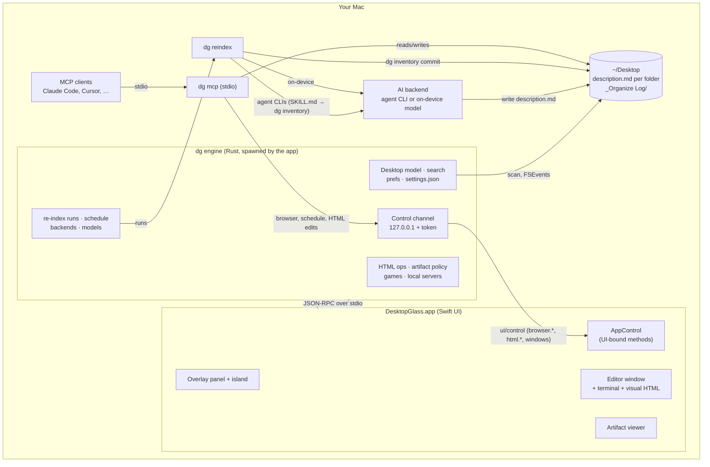
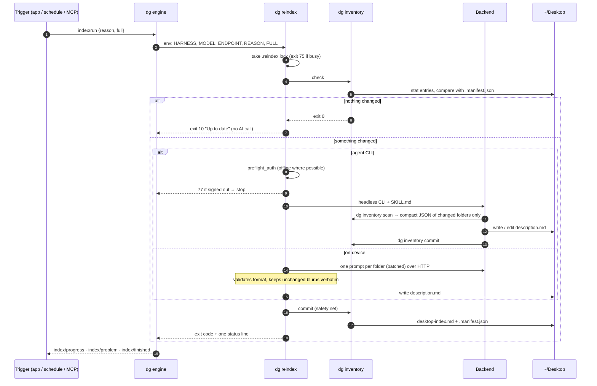
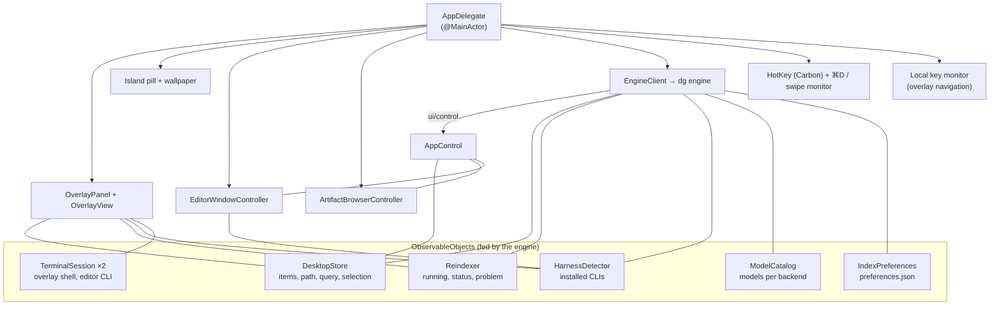
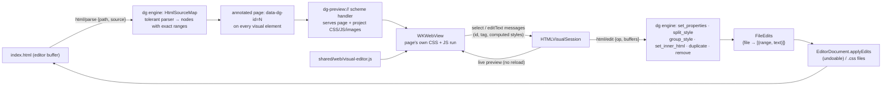
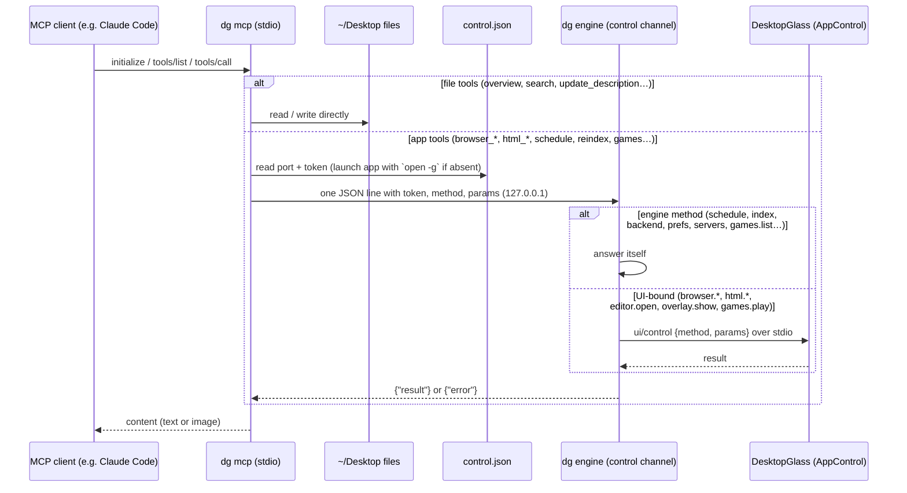

# DesktopGlass architecture

How the pieces fit, what each file does, and the decisions behind them. For using the app, see the
[README](README.md).

- [1. The big picture](#1-the-big-picture)
- [2. Tech stack](#2-tech-stack)
- [3. Repository layout](#3-repository-layout)
- [4. Data on disk](#4-data-on-disk)
- [5. Indexing pipeline](#5-indexing-pipeline)
- [6. The app](#6-the-app)
- [7. Editor](#7-editor)
- [8. Visual HTML editor](#8-visual-html-editor)
- [9. Artifact viewer](#9-artifact-viewer)
- [10. MCP server and control channel](#10-mcp-server-and-control-channel)
- [11. Security model](#11-security-model)
- [12. Extending DesktopGlass](#12-extending-desktopglass)

## 1. The big picture

DesktopGlass is three cooperating parts that share one source of truth: **plain files on your Desktop**. All
non-UI work happens in one Rust executable, `dg`, which ships inside the app bundle.



Design principles:

1. **Files are the API.** The app never stores descriptions in a database; it parses `description.md` files.
   Any tool (or person) that edits them is a first-class citizen.
2. **The app works without AI.** Browsing, the editor, the visual HTML editor and the artifact viewer need no model.
   AI only writes descriptions — and only when something changed.
3. **Bring your own model.** The indexing contract (`SKILL.md` + `dg inventory` JSON) is the same for seven agent CLIs
   and five on-device runtimes.
4. **Never destructive.** Nothing in the pipeline moves, renames or deletes user files.
5. **Thin UI, one engine.** The Swift app draws windows, WebViews, the editor and the terminal; everything else is
   in `dg`, so a Windows UI can reuse it (see [plans/README.md](plans/README.md)).

## 2. Tech stack

| Layer | Technology | Why |
|---|---|---|
| App language | **Swift 5.9**, Swift Package Manager (`Package.swift`), macOS 13+ | Native, no Xcode project needed; `swift build` from the CLI |
| Engine | **Rust** workspace (`engine/`), one binary `dg` (universal via `lipo`), copied to `Contents/MacOS/dg` | All non-UI logic in one static binary; no Python or zsh at runtime (MLX's own server aside) |
| UI | **SwiftUI** views hosted in **AppKit** windows (`NSPanel`, `NSWindow`, `NSHostingView`) | SwiftUI for layout; AppKit for floating panels, menus, key handling |
| Glass | `NSGlassEffectView` / `.glassEffect` on macOS 26 (Liquid Glass), `NSVisualEffectView` + `.ultraThinMaterial` before | Real system materials, compiled conditionally (`#if compiler(>=6.2)` + `#available`) |
| Text editing | **TextKit 1** (`NSTextView`, `NSLayoutManager` temporary attributes), custom `NSRulerView` gutter | Fast highlighting without touching file contents or undo |
| Terminal | **[SwiftTerm](https://github.com/migueldeicaza/SwiftTerm)** `LocalProcessTerminalView` (PTY) | Full xterm-compatible terminal; the only external Swift dependency |
| Web | **WebKit** `WKWebView`, `WKURLSchemeHandler`, `WKScriptMessageHandler`, `WKUserScript`; page scripts in `shared/web/*.js` | Artifact viewer and the visual HTML editor; the JS is shared with future UIs |
| App ↔ engine | newline-delimited **JSON-RPC 2.0** over the engine's stdin/stdout (`dg-proto`; `dg schema` prints it) | No FFI; an engine crash can't take the UI down |
| Control channel | loopback TCP in `dg engine` (`dg-engine/src/control.rs`) | How `dg mcp` reaches the running app |
| File watching | `notify` (FSEvents) in the engine | Pushes `desktop/changed` instead of polling |
| System | Carbon `RegisterEventHotKey`, `ServiceManagement.SMAppService`, `NSWorkspace`, `Process` (UI); `lsof`, CoreFoundation bookmarks (engine) | Global hotkey, launch at login, opening files; local servers, game shortcuts |
| On-device AI (Apple) | **FoundationModels** (`LanguageModelSession`), macOS 26 | Called by `dg` through the app binary (`--foundation-models`) |
| AI backends | Claude Code, Codex, Gemini CLI, Antigravity CLI (`agy`), Cursor CLI, Copilot CLI, OpenCode · MLX (`mlx_lm.server`), Ollama, LM Studio, llama.cpp | Agent CLIs via headless flags; local runtimes over plain-`http://` APIs |
| Protocols | **MCP** (JSON-RPC 2.0 over stdio, protocol 2024-11-05 → 2025-06-18) | One server (`dg mcp`) for every MCP-capable app |

## 3. Repository layout

```
DesktopGlass/
├── app.conf                    VERSION, BUILD, BUNDLE_ID — the app's identity, read by the build scripts and dg
├── Package.swift               SwiftPM manifest (DesktopGlass app + DesktopGlassTests; dependency: SwiftTerm)
├── install.sh / uninstall.sh   install or remove SKILL.md, the app, ~/.local/bin/dg + dgview, MCP entries, settings
├── scripts/build-app.sh        swift build + cargo build (dg) → .app bundle with a generated Info.plist, shared/web
│                               copied to Contents/Resources/web, ad-hoc signed
├── scripts/test.sh             rust | parity | swift (all three by default)
├── skill/desktopglass-index/
│   └── SKILL.md                the indexing instructions every agent follows (calls ~/.local/bin/dg inventory)
├── shared/web/                 JavaScript injected into WebViews: visual-editor, browser-read/click/type/eval,
│                               mermaid-render, markdown-report-size (loaded by WebScripts.swift)
├── engine/                     Rust workspace
│   ├── dg/src/                 the binary: main.rs (subcommands), inventory.rs, reindex.rs, mcp.rs, install.rs, engine.rs
│   ├── crates/
│   │   ├── dg-core/            rules, description.md parse/render, scan, manifest, assemble (desktop-index.md),
│   │   │                       prefs, paths, desktop_model (overlay model + search), html (source map + edits),
│   │   │                       artifact_policy, games, local_servers
│   │   ├── dg-index/           re-index pipeline: lock, harness (backends, CLI discovery), agent (command lines,
│   │   │                       SKILL.md→prompt, Seatbelt profile), preflight (sign-in, classify_failure), local
│   │   │                       (on-device pipeline), http, exit codes
│   │   ├── dg-mcp/             MCP server (35 tools, permission groups); files.rs = file tools, app.rs = control calls
│   │   ├── dg-install/         mcp-install (per-client config writers, migration from the Python installer),
│   │   │                       hooks (autoshow, session), guide (the CLAUDE.md/AGENTS.md block)
│   │   ├── dg-engine/          `dg engine`: link (stdio JSON-RPC), control (loopback listener), settings
│   │   │                       (settings.json), watch (FSEvents), methods/ (desktop, index/*, tools/*)
│   │   ├── dg-platform/        everything OS-specific (Desktop path, app support, open URL, read settings…)
│   │   └── dg-proto/           engine ↔ UI method and notification lists, control gates, SHARED_SETTINGS, schema
│   └── tests/
│       ├── golden/             descriptions/ (a .md + the .json it parses to) and fixture desktops/
│       └── parity/             parity.sh, mcp-parity.sh; reference/ = the old Python scripts, kept only for these
├── Tests/DesktopGlassTests/    XCTest (UI side only): HTML engine client, path security, accounts and Codex
│                               visualizations, conversation history
└── Sources/DesktopGlass/
    ├── App.swift               @main; also the --foundation-models CLI entry points
    ├── AppDelegate.swift       wiring hub: windows, morph animation, menus, hotkey, keyboard, starts the engine
    ├── AppInfo.swift           version/build from Info.plist
    ├── Models.swift            Layout constants, Item / FolderDescription (filled from the engine's desktop/load)
    ├── Store.swift             DesktopStore (browse state, engine search, keyboard selection), Editor, Actions
    ├── OverlayPanel.swift      borderless floating NSPanel with glass
    ├── OverlayView.swift       overlay UI: header, sidebar, cards, search, footer, problem chip, docked terminal
    ├── Island.swift            the pill at the top of the desktop (wallpaper button, DesktopGlass-mode switch),
    │                           sizes, ⌘D / swipe input, Finder icons and Dock auto-hide
    ├── Wallpaper.swift         custom wallpaper: image, looping video or YouTube embed (+ fallback file), picker
    ├── Apps.swift              the sidebar's Apps dropdown
    ├── Glass.swift             glass modifiers, icons
    ├── HotKey.swift            Carbon global hotkey
    ├── Settings.swift          Settings page, hotkey choices
    ├── IndexPreferences.swift  preferences UI (the engine's prefs/get · prefs/set)
    ├── MCPSection.swift        MCP install/test UI (runs dg mcp-install)
    ├── Harness.swift           backends: labels, presets, HarnessDetector / ModelCatalog (engine backends/detect, models/list)
    ├── Reindexer.swift         Schedule labels, IndexProblem; mirrors the engine's index/* state for the views
    ├── WebScripts.swift        loads shared/web/*.js from Contents/Resources/web (or the source tree)
    ├── FoundationModelsCLI.swift  Apple on-device model bridge
    ├── Editor/                 EditorWindow, EditorModel, EditorDocument, EditorView, Syntax,
    │                           MarkdownStyler, MarkdownVisuals, Terminal (SwiftTerm wrapper),
    │                           Conversations (past sessions per CLI, resume commands), DirectoryWatcher
    ├── GamepadNavigator.swift  game controller → overlay navigation
    ├── HTML/                   HTMLEngine (client of the engine's html/* methods: page map, destinations, applying
    │                           edits), HTMLVisualSession (WebKit plumbing, selection), HTMLVisualEditor (views)
    ├── Artifacts/              ArtifactPolicy (synchronous matcher over the engine's policy tables), ArtifactBrowser
    │                           (tabs, viewer window, local-server picker), ArtifactAccounts, CodexVisualizations
    ├── Games/                  GameLibrary (entries from the engine's games/scan, launch, play history), GamesLibraryView
    └── Control/                EngineClient (spawns dg engine, JSON-RPC, settings mirror), AppControl (UI-bound
                                control methods), ControlError
```

## 4. Data on disk

```
~/Desktop/
├── <Folder>/description.md          written by the backend, read by the app (one per "group" folder)
└── _Organize Log/
    ├── desktop-index.md             whole-Desktop summary, assembled by dg inventory commit
    ├── .manifest.json               per-folder entry signatures (size+mtime / mtime+count) for change detection
    ├── preferences.json             indexing preferences (engine prefs/get · prefs/set, edited in Settings)
    ├── questions.md                 "- [ ] date · Folder — question" items for the user
    ├── reindex.log                  raw output of every run, with backend, model and exit code
    └── .reindex.lock/               directory lock; stale after 30 minutes

~/.claude/skills/desktopglass-index/SKILL.md               copied by install.sh (the only file in the skill now)
~/.local/bin/dg                                            symlink → DesktopGlass.app/Contents/MacOS/dg
~/.local/bin/dgview                                        two-line wrapper: exec dg view "$@"
~/Library/Application Support/DesktopGlass/settings.json   shared settings (engine-owned, see below)
~/Library/Application Support/DesktopGlass/control.json    {port, token, pid}, mode 600, while the engine runs
~/Library/Application Support/DesktopGlass/Wallpapers/     the custom wallpaper (copied files, <id>.youtube links)
~/Library/Preferences/<BUNDLE_ID>.plist                    UserDefaults: UI-only settings (hotkey, editor, island…)
                                                           plus a mirror of the shared settings for SwiftUI bindings
```

**`settings.json`** holds what both the engine and the UI need: `harness`, `model.*`, `endpoint.*`, `schedule`,
`scheduleHour`, `mcp.allow.*`, `unattended.*`, `sandboxUnattended`, `signedOutHarness`, `lastReindexRun`,
`lastReindexSuccess`, `gamesFolder` (`dg_proto::SHARED_SETTINGS`). On first start it is migrated once from
UserDefaults; afterwards `EngineClient` mirrors it both ways (`settings/get|set`, `settings/changed`). One-shot
commands (`dg reindex`, `dg mcp`) read it through `dg_platform::read_setting`.

**`description.md`** — a small, line-oriented format both humans and parsers can handle:

```markdown
# Projects
> Active software projects, grouped by product.          ← summary (one line, ≤120 chars)
Tags: swift, web, ai

## Contents
- **MyApp/** — Example web app · Next.js, Supabase.      ← one bullet per entry, `**name**` then ` — blurb`
- **notes.md** — Running list of ideas.

## Notes
Anything else, including answered questions.
```

Parsed by `dg_core::description::parse` (the indexer's rules) and `dg_core::desktop_model::FolderDescription::parse`
(what the overlay shows; the app's original rules).

**Which folders get a description.** A *group* is a directory at depth ≤ 3 that is not a package (`.app`, `.band`…)
and not a *project*. A project is any directory containing a marker (`.git`, `package.json`, `Package.swift`,
`requirements.txt`, `README.md`, …); projects are described by their parent so repositories stay untouched.
These rules live in one place: `engine/crates/dg-core/src/rules.rs`.

**`preferences.json`**

```json
{ "version": 1, "style": "terse", "private": ["Documents"], "skip": ["Games"], "flagStatus": true, "notes": "…" }
```

`private` = names only; `skip` = never described. `dg inventory` enforces both, so no backend can ignore them.

## 5. Indexing pipeline

Every trigger — the Re-index button, the menu, the schedule (checked by the engine every 60 seconds, with a catch-up
at launch), Settings → Rewrite All, or the `reindex_desktop` MCP tool — becomes an `index/run` in the engine, which
runs `dg reindex` as a child process (so a run can be cancelled with `index/cancel`; there's no button for it yet).



**Exit codes** (`dg_index::exit`, interpreted by the engine; the app shows the result):

| Code | Meaning | App behaviour |
|---|---|---|
| 0 | indexed | clear problems, record success |
| 10 | nothing changed | record success, no tokens spent |
| 75 | already running | ignore |
| 76 | usage / rate limit | warning chip |
| 77 | not signed in | warning chip with **Sign In**, scheduled runs paused (persisted) |
| 78 | local model / server not ready | warning chip with **Open …** |
| 79 | unattended runs not allowed for this CLI | warning chip with **Review…** (consent dialog) |
| 127 | backend not installed | warning chip → Settings |

**Token economy.** `dg inventory scan` replaces exploration: it sends only changed folders, marks unchanged entries
`{"n": name, "keep": blurb}` for verbatim copying, pre-extracts hints (stack from `package.json`/`requirements.txt`,
first README line, top-level names), caps folders at 40 entries, and skips `node_modules`, `.venv`, `.git`, `dist`…
`SKILL.md` forbids directory listing and limits file reads to 5 heads per run. Assembly (`commit`) needs no AI.
The scan JSON is byte-compatible with the old `inventory.py` (checked by `engine/tests/parity/parity.sh`).

**Agent CLIs vs on-device.** Agent CLIs execute `SKILL.md` themselves (Claude Code as an installed skill; the others
receive `SKILL.md` as the prompt via `dg_index::agent::skill_prompt`). On-device models can't run tools, so
`dg_index::local` plays agent: it builds one prompt per folder (smaller batches for Apple's ~4k-token model), strips
`<think>` blocks and code fences, parses the reply, retries once on format errors, and writes the file itself. Every
local runtime is reached over plain `http://` (Ollama's API or the OpenAI-compatible one); MLX runs as
`mlx_lm.server`, which `dg` starts on a free port if none is running and a Python with `mlx-lm` exists. Apple
Foundation Models goes through the app binary's `--foundation-models` entry point.

**Sign-in detection.** `dg_index::preflight::preflight_auth` uses offline checks (`codex login status`,
`cursor-agent status`, `opencode auth list`, credential files/keychain for Claude and Gemini) and only blocks on
definite answers. After a failed run, `classify_failure` scans the output tail for auth and rate-limit patterns (the
pattern tables are data, tested against captured CLI output).

**CLI discovery.** Apps launched from the Dock get a minimal `PATH`, so `dg_index::harness` resolves the login-shell
`PATH` once, caches it, and adds the usual install folders (Homebrew, npm, bun…). The app's backend list comes from
the engine's `backends/detect`, model lists from `models/list` (live lists from local servers, `http://` only).

## 6. The app

`AppDelegate` is the wiring hub. It owns long-lived objects and passes them to views; there is no global singleton
state apart from small shared catalogs and `EngineClient.shared`.



- **The engine link.** `EngineClient` spawns `Contents/MacOS/dg engine`, speaks newline-delimited JSON-RPC 2.0 over
  its stdin/stdout, and restarts it with backoff (1 s, 2 s, 4 s … 30 s) if it exits. Once the engine answers
  `engine/hello`, `EngineClient` fires a local `engine/ready` event and each model (re)loads from the engine
  (desktop, preferences, index status, model presets, the artifact policy tables). The app needs the bundled engine;
  there is no in-app fallback. The full method and notification list is
  `dg_proto::UI_METHODS` / `NOTIFICATIONS` (`dg schema` prints it).
- **The Desktop model.** The engine scans the Desktop (`desktop/load`: groups to depth 3 with their parsed
  `description.md`; projects and deep folders load on open via `desktop/list`) and answers search (`desktop/search`).
  `DesktopStore` reloads when the engine sends `desktop/changed` (FSEvents) and keeps only selection and keyboard
  state. Indexing preferences go through `prefs/get` / `prefs/set` (engine/crates/dg-engine/src/methods/desktop.rs).
- **Re-indexing.** `Reindexer` calls `index/run`, `index/check_auth` and `index/status` and mirrors `index/progress`,
  `index/problem` and `index/finished` for the problem chip; the schedule, lock and exit-code handling are in
  `dg-engine/src/methods/index/`.
- **Activation policy.** The app is an *accessory* (menu bar only) and becomes *regular* (Dock, ⌘-Tab) only while the
  editor or artifact viewer is open.
- **The island.** A small always-on pill window at the top of the desktop (`Island.swift`). ⌘D (from any app) and a
  two-finger swipe at the top edge are caught by one Accessibility event tap (without the permission, the hotkey,
  clicking the pill and swiping over it still work). The pill's
  wallpaper button opens a picker (`Wallpaper.swift`: an image, a looping muted video, or a YouTube link played
  through the embedded player with a fallback file); its switch toggles **DesktopGlass mode**, which hides Finder's
  desktop icons (`com.apple.finder CreateDesktop`), shows the wallpaper and turns on Dock auto-hide, restoring the
  user's own Dock setting when turned off.
- **The morph.** Opening the editor animates the overlay panel and the editor window to the same frame while
  cross-fading (`NSAnimationContext`, 0.42 s); going back reverses it. Tabs and terminal survive.
- **Terminal.** The overlay's agents terminal is docked on the right and starts collapsed to a slim rail each launch
  (⌃\` or the rail expands it).
- **Keyboard.** A local `NSEvent` monitor handles overlay navigation and steps aside for the terminal and Settings.

## 7. Editor

| Piece | Role |
|---|---|
| `EditorModel` | workspace root, file tree rows, open documents, Quick Open index (background enumerator, skips build dirs), visual sessions |
| `EditorDocument` | one file: its own `NSTextView` (so undo, scroll and selection persist per tab), dirty state, save, reload-on-change, `applyEdits` for programmatic edits |
| `SyntaxHighlighter` | regex rules + a single-pass scanner for strings/comments, applied as **temporary attributes** (never stored in the file, never in undo) |
| `MarkdownStyler` | Preview mode: real attributes on the text storage (headings, emphasis, code, links), still fully editable |
| `MarkdownVisuals` | Preview visuals: finds ```` ```mermaid ````/```` ```svg ```` fences and images, renders each in a subview under its source (WKWebView for Mermaid/SVG, NSImageView for rasters), reserves room via paragraph spacing, and collapses the source unless the caret is inside it. Nothing is ever written to the file. Mermaid is bundled at build time, with a pinned CDN fallback |
| `LineNumberRuler` | transparent `NSRulerView` gutter |
| `TerminalSession` | SwiftTerm PTY running `$SHELL -l -c "cd …; <cli>; exec $SHELL -l"` so the shell remains when the CLI exits |

Files are read as UTF-8 (Latin-1 fallback); binaries and files over 8 MB open in their default app instead.

## 8. Visual HTML editor

The core idea: **the rendered page is only a view; every edit is a precise text edit of the source.** The engine
computes every parse and edit (`dg_core::html`); the app renders, handles selection and applies the edits.



- **Parser.** `HtmlSourceMap` records each element's start tag, end tag and children as UTF-16 ranges (exactly like
  `NSRange`). It handles comments, doctype, void elements, raw-text elements (`script`, `style`, `textarea`…) and
  **implied end tags** the way browsers do (`<li>One <li>Two`, `<p>…<div>`, table rows/cells, `<option>`), closing
  them with zero-length ranges. `HTMLEngine.swift` keeps a snapshot (`HTMLPageMap`) for selection and labels.
- **Buffers, not files.** Edits are computed against the open (possibly unsaved) editor buffers the app sends along,
  and come back as `FileEdits` that `EditorDocument.applyEdits` applies as one undoable step.
- **Selection.** Clicks report the element's id and tag; the session checks the page still matches the file and
  re-renders if not. Elements created by JavaScript have no id; they're shown as *from JS* and can only be styled
  through CSS rules.
- **Where styles go.** `StyleDestination` = a linked local stylesheet (default), the page's `<style>` block, or inline.
  Rule edits locate `selector { … }` blocks and rewrite them in place; missing rules are appended.
- **Split / Group** are stylesheet operations: they change only `class` attributes in HTML and write rules to CSS.
- **Text editing.** Double-click makes the element `contentEditable`; on commit the script sanitizes to inline tags
  and sends HTML; `set_inner_html` validates (inline tags only, no handlers, no comments lost) and replaces the
  element's inner range.
- **After structural edits** the page re-renders and the selection is restored by tree path + tag.
- **Scope.** Built for vanilla HTML/CSS/JS. Framework apps render, but most of their DOM is JavaScript-made.

The `html_*` MCP tools reach the app (`html.*` control methods are UI-bound because they need the open buffers);
`AppControl` hands them back to the engine as `html/control` with those buffers, so AI edits and manual edits run
the same code.

## 9. Artifact viewer

- **Policy.** The rules live in `dg_core::artifact_policy`. WebKit asks synchronously, so `ArtifactPolicy.swift`
  fetches the engine's tables (`policy/tables`: extensions, artifact and sign-in hosts, path rules…) at
  `engine/ready` and evaluates them with a small matcher (documented and tested against the Rust predicates in
  `dg-engine/src/methods/tools/policy.rs`). **Until the tables arrive nothing is allowed or handed off**; callers that
  open things at start-up wait with `whenLoaded`.
- **Allow-list.** Local files of web/document types, `localhost`/`127.0.0.1`, and known artifact/preview hosts
  (Claude, ChatGPT canvas, Gemini, v0, Lovable, Bolt, StackBlitz, CodeSandbox, Vercel, Netlify, Pages, GitHub Pages,
  Hugging Face). Main-frame navigations elsewhere go to the default browser; iframes inside an artifact load freely.
- **Where pages show.** `ArtifactBrowserController.shared` owns every page (`ArtifactTab`), so the MCP browser tools
  see them all. A tab's `inEditor` decides where it's drawn: the editor's tab strip and code area (`WebTabItem`,
  `EditorWebPane`, selected through `EditorModel.activeWeb`) or the viewer window. `open(_:placement:)` uses the
  editor whenever its window is open; `move(_:toEditor:)` pops a page out or back. A `WKWebView` can only have one
  superview, so the page itself moves rather than being copied.
- **Sign-in.** The policy's sign-in table lists identity hosts (claude.ai, OpenAI, Google, Apple, GitHub, Microsoft,
  Vercel, …). Navigations to them are allowed inside a tab that's already showing an artifact, and sign-in popups
  load in the same tab, so the session lands in the viewer's persistent cookie store. They're never opened directly.
  The views identify as Safari, since some providers refuse embedded browsers.
- **Accounts** (`ArtifactAccounts`, `SignInWindow`): sign-in windows share the default `WKWebsiteDataStore` with
  every viewer tab, so one sign-in covers that site's artifacts. Status is just "does a session cookie of this name
  exist" (`ArtifactAccount.isSession`); values are never read. Sign-out deletes that site's cookies and data records.
  `SignInPopups` hosts `window.open` popups with the opener's configuration and closes them on `window.close()`.
- **Codex visualizations** (`CodexVisualizations`): every 2 s, looks for `.html` files in today's and yesterday's
  `YYYY/MM/DD` folders under `$CODEX_HOME/visualizations` and the editor root's `.codex/visualizations`, wraps each
  fragment as a full page in `~/Library/Application Support/DesktopGlass/Codex Visualizations/<thread>/`, and opens
  new ones (updates just rewrite the page, which the open tab reloads).
- **Asked for by name.** `open(_:explicit:)` — from `dgview`/`dg view`/`desktopglass://`, `show_artifact`,
  `browser_navigate` and the address bar — also accepts any web page (the policy's *on request* rule), and marks the
  tab `openWeb` so its links stay in the viewer. Other tabs keep the artifact allow-list. New tabs start at
  `about:blank` with a start page (`WebPage`) and a focused `AddressBar`.
- **Hand-off.** Only `http(s)` pages with a host and `mailto:` may leave the viewer. File URLs and other schemes are
  dropped rather than given to `NSWorkspace`, which would launch an `.app` or run a `.command` — these URLs can come
  from an MCP client, a `desktopglass://` link on a web page, or a page in the viewer.
- **Resolving.** The engine's `policy/resolve` turns a path, `~/path`, Desktop-relative path, bare host or
  address-bar text into a URL; a path that doesn't exist resolves to nothing (never to a web address).
- Local files are polled for modification once a second and reloaded — so an AI rewriting `chart.html` updates live.
- **Local servers.** The engine's `servers/list` (`dg_core::local_servers`) runs `lsof`, drops system daemons, then
  probes each port with one HTTP request and reads `<title>`. The engine's own control port is excluded.
- Entry points: `desktopglass://open?url=…` (registered URL scheme), `dg view` / `dgview`, editor **View**, the
  menu, and MCP.

## 9b. Games library

Active only at the top level of the Games folder (`DesktopStore.libraryActive`); there it replaces the folder grid,
reusing the overlay's keyboard selection.

- **Scan** (engine `games/scan`, `dg_core::games`): enumerates the Games folder to depth 4 without entering packages
  and lists every `.app` bundle as a Mac game. Emulation (console ROMs, disc detection, emulator launching) was
  removed.
- **Shortcuts.** Finder aliases and symlinks in the Games folder are resolved during the scan; a `GameEntry` keeps both
  the shortcut (`url`, the card's identity) and the real app (`target`, what gets launched). Shortcuts to anything
  that isn't an `.app` are ignored.
- **Launch:** `NSWorkspace.openApplication` in the app; `PlayHistory` keeps the last-played time per entry
  (`games.lastPlayed`, passed to the engine with `games/history` for sorting) for the *Recently Played* sort;
  `GameLibrary.onLaunched` hides the overlay.
- **Controller** (`GamepadNavigator`): GameController with `shouldMonitorBackgroundEvents`; D-pad/stick (with
  key-repeat timing), A, B and Y map to the overlay's move/activate/back/search, and only while the overlay is visible.
- **MCP:** `list_games` (answered by the engine) and `play_game` (gate `mcp.allow.play`, UI-bound `games.play`).
  `platform` is always `Mac` / `mac`.
- **Find Games** (engine `games/search` + `games/add_shortcuts`): apps whose `LSApplicationCategoryType` contains
  *games* and `.app` bundles in Steam libraries (`libraryfolders.vdf`); results already in or linked from the Games
  folder are dropped. Shortcuts are Finder aliases written through CoreFoundation's bookmark API.

## 10. MCP server and control channel



- `dg mcp` (`dg-mcp`) speaks JSON-RPC 2.0 over stdio, negotiates the protocol version, and never prints anything but
  protocol messages to stdout. Its 35 tools keep the names, schemas and result shapes of the old Python server
  (`engine/tests/parity/mcp-parity.sh` checks them).
- **Why a control channel?** Browser automation, visual HTML edits against open (possibly unsaved) editor buffers,
  and settings changes must happen inside the running app or engine. File-only tools work even when the app is
  closed.
- **The control channel lives in `dg engine`** (`dg-engine/src/control.rs`): a loopback TCP listener on a random
  port, `control.json` `{port, token, pid}` (mode 600, removed when the engine exits), newline-delimited JSON
  `{"token", "method", "params"}` → `{"result": …}` or `{"error": "…"}`, token-checked per request. Permission gates
  (`dg_proto::gate`) are checked there first; `AppControl` checks the UI-bound ones again.
- **`dg mcp-install`** (`dg-install`: `status | install | uninstall | refresh | test`) edits each client's own config
  format (JSON `mcpServers`/`servers`/`mcp`, Codex TOML, or `claude mcp add` / `codex mcp add`), backs files up once,
  skips files it can't parse, and includes a self-test (`test`). Registrations run `~/.local/bin/dg mcp`; hooks run
  `dg hook session --format <cli>` (every agent CLI) and `dg hook autoshow` (Claude Code `PostToolUse`). Both hooks
  act only when `TERM_PROGRAM=DesktopGlass`. `refresh` rewrites registrations and hooks left by the old Python
  installer (`python3 …/mcp_server.py`, `autoshow.py`, `session_context.py`) to `dg`. The marked block it adds to each
  CLI's global instructions (`dg_install::guide`) now only points agents at the Desktop index tools.

## 11. Security model

| Surface | Protection |
|---|---|
| Agent CLIs in auto-approve modes | **opt-in per CLI** (`unattended.<cli>`; `dg reindex` exits 79 without it, schedules skip); each CLI's own permission controls (Claude allow-list, Codex sandbox, Copilot `--allow-tool`); optional **Seatbelt sandbox** via `sandbox-exec` (off by default) — writes only to `description.md`, `_Organize Log`, temp and CLI state; CLI settings/hooks/skills and DesktopGlass's skill write-protected; credential folders unreadable. On-device backends run no commands. |
| MCP tools | read-only by default; *edit*, *control*, *script* and *play* groups opt-in (`mcp.allow.*`), enforced in `dg mcp` (hidden from `tools/list`, refused on call), in the engine's control channel and again in `AppControl`; paths confined to `~/Desktop` (symlinks resolved first; `resolve_question` never writes outside it); values written to description.md are forced onto one line so they can't add headings or bullets; nothing is moved or deleted |
| Control channel | in `dg engine`: loopback only, random token in a mode-600 file, removed when the engine exits |
| Artifact viewer | host allow-list for top-level navigation (deny-all until the engine has sent its tables); only web and mail links are handed to other apps |
| In-place HTML editing | inline-tag allow-list, `on*` handlers and `javascript:` URLs rejected |
| Secrets | none stored; CLIs keep their own credentials |

Documented trade-offs are in the README's Safety section.

## 12. Extending DesktopGlass

**Add an agent CLI.** Add a case to `Harness` (label, binaries, presets, `terminalCommand`), then to
`dg_index::harness` (`AGENTS`, `label`, `login_hint`, `find_bin`), `dg_index::preflight` (`preflight_auth`, status
checks), `dg_index::agent` (`headless`, `interactive`, `login`) and the engine's `methods/index/backends.rs` (the
ids, labels and defaults Settings shows). Add its config writer and hook to `dg-install` if
it speaks MCP.

**Add an on-device runtime.** Implement the `Backend` trait in `dg_index::local` (`ping` + `chat` over HTTP), add it to
`LOCALS` and `make_backend`, add a `Harness` case marked local, and add it (default endpoint, model list) to the engine's
`methods/index/backends.rs`.

**Add an MCP tool.** Add its schema to `engine/crates/dg-mcp/src/tools.json` and a case to the dispatch in `lib.rs`. File-only: write the
handler in `files.rs`. App-backed: call `via_app("method", args)`, then answer the method in the engine
(`dg-engine/src/methods/`) or, if it needs windows, WebViews or editor buffers, mark it UI-bound in
`dg_proto::is_ui_bound` and handle it in `AppControl.handle`. Add a gate in `dg_proto::gate` if it writes or acts.

**Add an engine method for the UI.** Handle it in `dg-engine/src/methods/`, list it in `dg_proto::UI_METHODS` (or
`NOTIFICATIONS`), and call it with `EngineClient.shared.call("…")`.

**Add a syntax language.** Add a `Language` definition and a case in `Language.detect` (`Editor/Syntax.swift`).

**Change folder rules.** Update `engine/crates/dg-core/src/rules.rs` — the only copy.

**Change the description.md format.** Update `dg-core`'s `description.rs` and `desktop_model.rs`, then add a case to
`engine/tests/golden/descriptions/` (a `.md` and the `.json` it should parse to) — the Rust tests read it. If the
indexer's output changes on purpose, the parity reference in `engine/tests/parity/reference/` no longer applies;
update or retire the parity check.

**Tests.** `scripts/test.sh` runs `rust` (`cargo test --workspace`), `parity` (`parity.sh` and `mcp-parity.sh`
against the Python reference copies; needs `python3`) and `swift` (`swift test`, UI-side only); pass one of those
names to run just that suite. The Swift tests build their scratch folders in code (`TestSupport.swift`).
